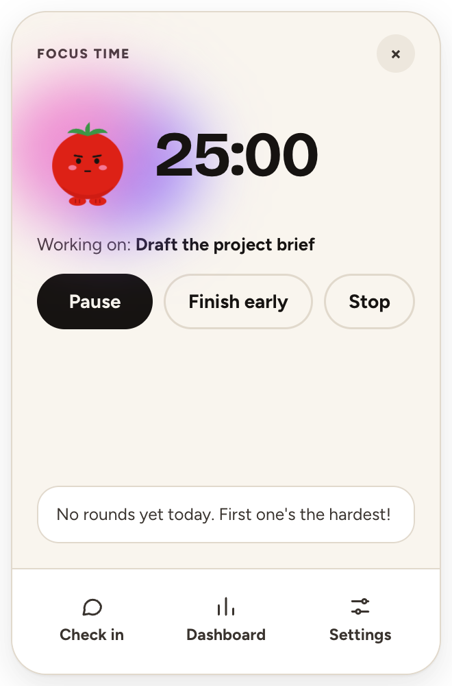
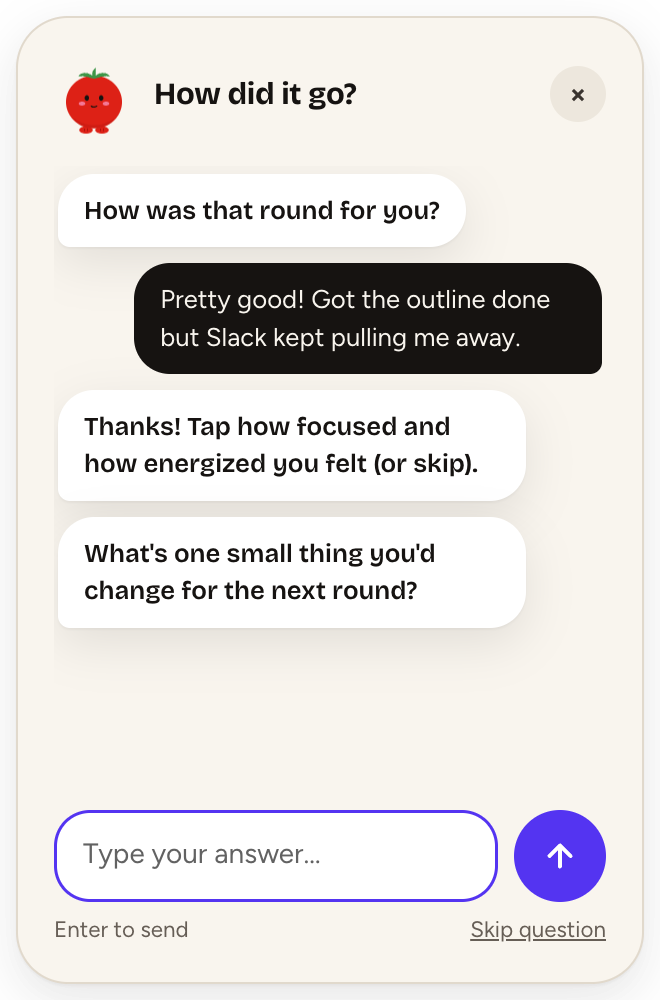
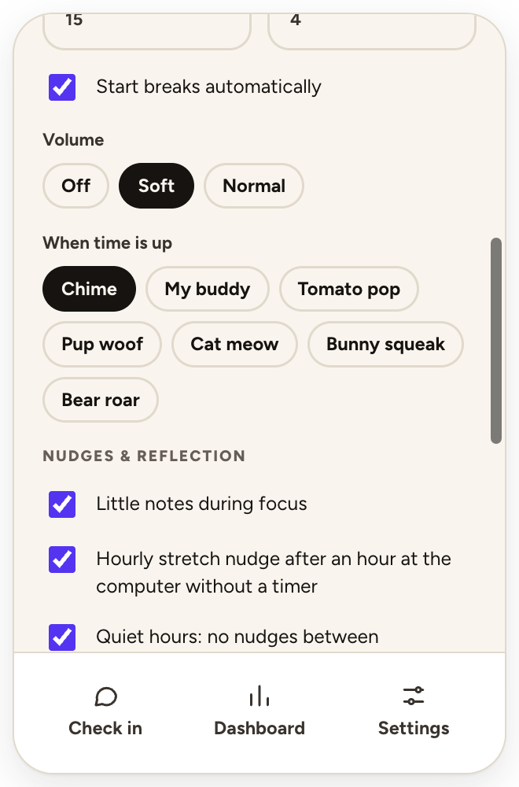

<p align="center"></p>

<h1 align="center">Focus Buddy</h1>

<p align="center">A little pet that lives on your Mac desktop, runs your Pomodoro timer,<br>reminds you to take breaks, and helps you notice how you work.</p>

<p align="center">
  <a href="https://github.com/nicolebackman/focus-buddy/releases/latest"><b>Download for Mac</b></a> ·
  <a href="https://nicolebackman.github.io/focus-buddy/">Website</a> ·
  <a href="#install">How to install</a>
</p>

---

## What it does

- **A Pomodoro timer that sits with you.** 25 minutes of focus, 5 minute breaks and a longer break every fourth round, all adjustable. The countdown also shows in your menu bar next to a tiny tomato.
- **A quick check-in after each round.** Your buddy asks how it went and how focused and energized you felt.
- **A dashboard of your week.** Focus minutes, how you've felt while working, and every reflection you've written.
- **Your own time's-up sound** *(new in 1.2)*. The standard chime, or your buddy's own voice: tomato pop, pup woof, cat meow, bunny squeak or bear roar.
- **Stretch reminders** once an hour without a timer. Time away from the computer doesn't count, and quiet hours keep the evenings calm.
- **Optional smarter questions.** Add your own Anthropic API key and Claude writes follow-up questions and reviews your patterns.

<p align="center">
  
  
  
</p>

## Install

1. Download the latest `.zip` from the [Releases](https://github.com/nicolebackman/focus-buddy/releases/latest) page and unzip it.
2. Drag **Focus Buddy** into your Applications folder.
3. Focus Buddy isn't signed with a paid Apple developer certificate, so macOS may say it's "damaged". It isn't. Open Terminal, paste this and press Return:
   ```bash
   xattr -cr "/Applications/Focus Buddy.app"
   ```
4. Open Focus Buddy. Your buddy appears in the bottom-right corner. **Drag** it anywhere, **tap** it for the timer and settings, **right-click** it for the menu.

Needs a Mac with an Apple chip (M1 or newer). The app tells you when a new version is out.

## Your data

Your reflections, settings and API key are saved only on your own Mac, in `~/Library/Application Support/Focus Buddy/`. The API key is encrypted with your Mac's Keychain. Without a key, nothing you write leaves your computer. See everything you've written under **Open dashboard** in the menu.

## Develop

Focus Buddy is an Electron app written in plain JavaScript (no framework).

```bash
npm install
npm start
```

| Path | What it is |
| --- | --- |
| `main.js` | Main process: timer, saving, windows, menu bar, update check |
| `ai.js` | The optional Claude calls |
| `renderer/` | The pet, panel and dashboard windows; `sounds.js` has the synthesized sounds |
| `docs/` | The website (GitHub Pages) |
| `tools/` | Release script and screenshot helpers |

### Release a new version

1. Bump `version` in `package.json`.
2. `npm run release` builds `release/Focus-Buddy-<version>-mac-arm64.zip` and publishes it as a GitHub release
   (uses the `gh` CLI if installed; otherwise prints the steps to upload it by hand).
